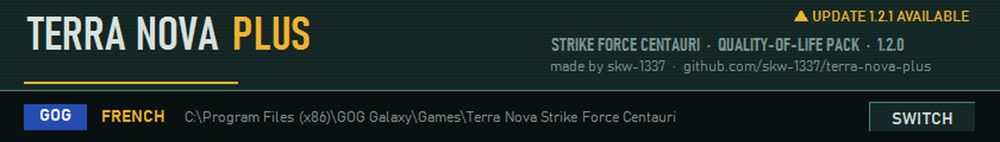
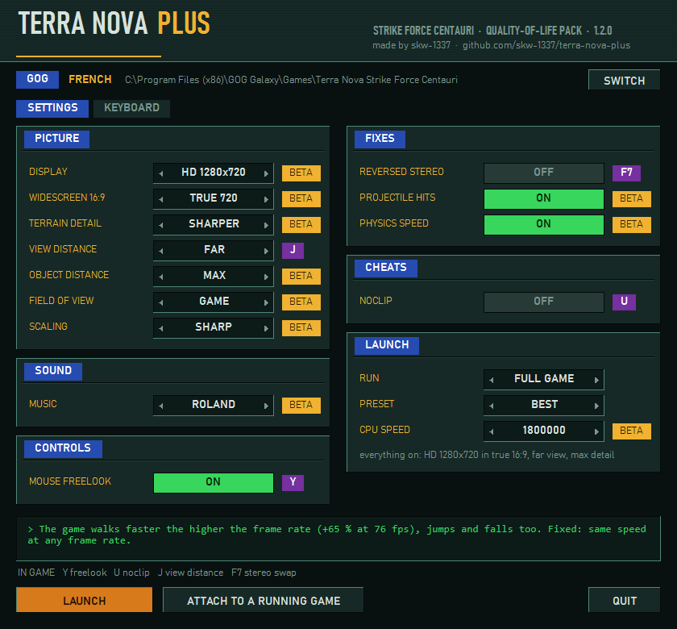
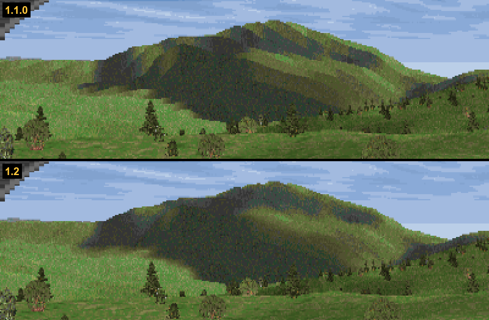
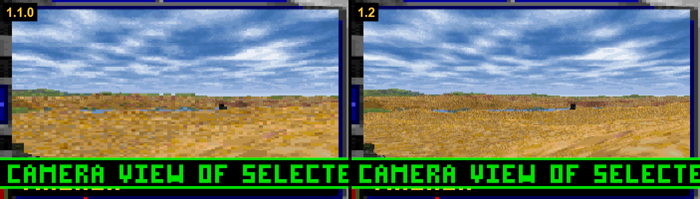
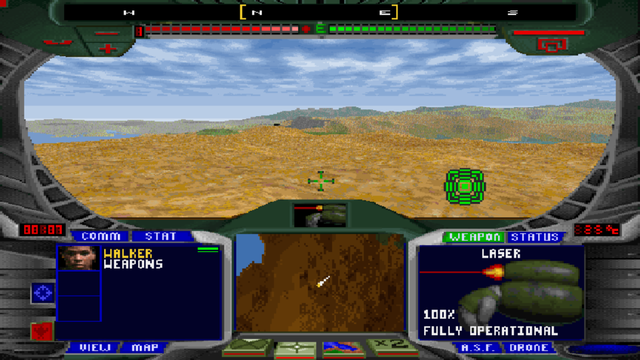
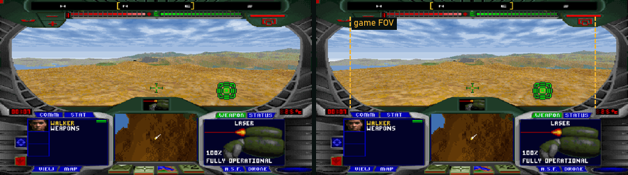
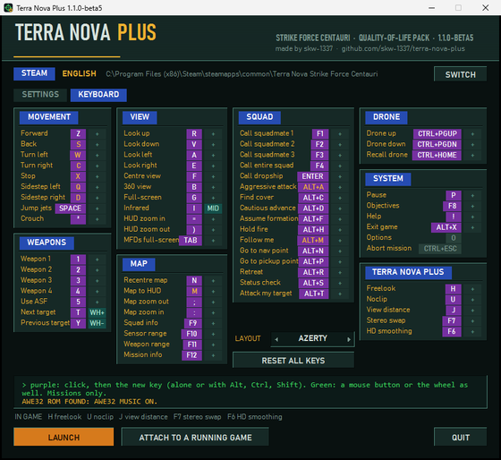

# Terra Nova Plus

**An all-in-one quality-of-life pack for *Terra Nova: Strike Force Centauri*** (Looking Glass Technologies, 1996), running in DOSBox — **Steam, GOG or standalone**.

*Made with the help of Claude Code (an AI coding tool), mostly for reverse engineering the game and writing the code. Every change is tested in the real game before release.*

One small external tool. Pick your options in its window, click Launch, and the game starts with them:

| Option | Key in game | What it does |
|---|---|---|
| **Mouse freelook** | `Y` | Mouse left/right turns your PBA, up/down looks up/down, the aiming reticle stays centred: you fire where you look. Smooth (~500 updates per second), no screen shake, no reticle trails on the cockpit. |
| **Noclip** | `U` | Free flight: your usual move keys, `Space` / `Left Ctrl` up/down, `Left Shift` ×4 speed. Great to explore the maps and look at the scenery. |
| **View distance** | `J` | `NORMAL` / `FAR`: the fog is pushed back, the horizon opens up. |
| **Display** | — | `ORIGINAL`, `320x400` (the engine's best resolution, applied in every mission: the game normally only keeps it in save files), or HD: `640x400` (the 3D drawn at twice the width), `848x480` or `1280x720` (true 16:9). |
| **Widescreen 16:9** | — | `STRETCHED`: DOSBox stretches the picture to 16:9 and the tool widens the field of view to match (correct proportions in the 3D, the cockpit is stretched). `TRUE` (HD): the 3D is drawn in a real 16:9 picture (848 columns, sharper than STRETCHED), the cockpit and HUD are stretched to the full width like in STRETCHED. `TRUE 720`: the same in 1280x720. |
| **Scaling** | — | `SHARP` (default): DOSBox draws with OpenGL and its sharp shader, every pixel the same size on screen, less shimmer when the view moves. `GAME'S OWN`: the edition's setting. |
| **Field of view** | — | `GAME` / `90` / `100` / `110` degrees for the 3D view, cockpit and full view, at every zoom level (the game: 84.5, about 101 in 16:9). The small cockpit cameras keep theirs. Works in 4:3 and in 16:9. |
| **Terrain detail** | — | `GAME` / `SHARP` / `SHARPER`: smooth ground up to 32 or 48 cells instead of 12 (no stair steps on near slopes), more detail far away. |
| **Object distance** | — | `GAME` / `FAR` / `MAX`: scenery, units and buildings drawn farther. |
| **Keyboard** | — | Every game command on the key you want, layout presets (WASD, ZQSD...), mouse buttons and wheel. |
| **Fixes** | `F7` | Projectiles hit at any frame rate (and no longer go through turrets), physics at the same speed at any frame rate, a smooth infrared view, the zoom kept after the Options screen, no black screen at the end of a mission, reversed stereo under DOSBox (`F7` compares). |
| **Music** | — | Roland / General MIDI, Sound Blaster FM, or the game's own AWE32 bank (you bring the AWE32 ROM). |

Everything happens in memory while you play, except two files: for HD, terrain detail, field of view, 16:9 and changed game keys TNPlus patches `TNOVA\__FF.EXE` once, and Music is written in the game's `TN.CFG`. The untouched files are kept as `*.tnplus-original`.

## 1.2

**Latest: [1.2.4](https://github.com/skw-1337/terra-nova-plus/releases/tag/v1.2.4)**:
- **GOG**: Galaxy's default build (1.08) is recognized, and the launcher tells you to switch to GOG's Beta branch instead of "GAME NOT FOUND" (see **GOG** under [Download & use](#download--use)).
- Small fixes found by the new automatic tests: view distance on `I` no longer goes back to `J` at every start, an empty `TNPlus.ini` keeps HD, `game_dir` in quotes no longer crashes the tool, a typo in `terrain_fps` is ignored, Colemak is no longer taken for Dvorak, QWERTZ names its Ö key, layout presets leave Options on `O`, and the demos keep your own DOSBox key map.

1.2.3 added **thicker smoke** (FIXES), Ashford shown as Deceased on the Outfit screen, clouds that no longer jump and a drone damage fix (original bugs fixed by Callemann in [TNova Native](https://github.com/Murplugg/Terra-Nova-SFC-improved)), more second key binds, keys released when the game goes to the background, and the **SAVES** button.

1.2.2 fixed a crash at the first key press in a mission, with Attach or the ORIGINAL preset, on a game never launched from TN+ with HD, terrain detail, field of view or 16:9. Since 1.2.1 the launcher shows when a newer version is out (top right, click to open the download page; `update_check = 0` turns it off):



The 1.2 launcher, with the BEST preset (the default):



- **HD 1280x720**: the 3D is drawn 1280 pixels wide and 1.5 times taller, in true 16:9. It's the new BEST preset and the default for a new install. A small frame counter sits top right (`fps_counter = 0` hides it).
- **Much faster in DOSBox**: a lot of the game's 3D code rewrote itself while running, which DOSBox handles badly. Those spots are fixed, same picture (most of them in 1280x720 only): on Panama I get about 75 to 100 fps in 1280x720. The default CPU speed is now 1800000. If your PC can't keep up, try HD 848x480 or a lower CPU speed.
- **No more stair steps on far slopes** (1280x720): the distant ground was shaded in blocks along the terrain grid. It's shaded smoothly now.



- **Cockpit cameras in HD** (1280x720): the squadmate, target and drone views in the cockpit are drawn in HD too, with smoother ground.



- **Walls near the screen edges** no longer disappear with a wide field of view (first missions, close to walls).
- **Infrared** no longer breaks far away after using the full view (`G`) in 1280x720.
- **Clicking a unit in the 3D view** (squad orders) now works in 1280x720.
- **View distance**: FAR is now the farthest. MAX showed the edge of the map.
- **Launcher**: Display lists every resolution, Widescreen follows.

## 1.1.0

Everything from the five betas, plus the fixes below.

This is a big one. I rewrote the launcher and added a bunch of things people asked for on TTLG, thanks to [](https://www.ttlg.com/forums/member.php?u=77813). Tell me what breaks.

### Since beta 5
- **Infrared view**: as smooth as the normal view (it dropped to about 35 fps when turning fast).
- **Shots no longer go through turrets** (particle beam in mission 26, sometimes the multipulsar).
- **The zoom stays** after the Options screen.
- **Mission 26**: the descrambler text scrolls at the original pace, readable again, and in true 16:9 the pirate cockpit no longer lets bits of the 3D through its frame.
- **Soldiers standing still** fidget at the original pace, not 4 times faster.
- **Key maps**: if your DOSBox already remaps the keyboard, it no longer stacks with the KEYBOARD tab.

The turret, descrambler and infrared fixes come from Callemann's [TNova Native](https://github.com/Murplugg/Terra-Nova-SFC-improved), ported to the DOSBox game.

### New launcher
- Since beta 3 it's a real window, in the colours of the game's cockpit. Hover a setting to read what it does at the bottom. `TNPlus.exe --console` keeps the old text menu.
- A badge shows which copy of the game you're launching: **GOG**, **STEAM** or **OTHER**, plus its language. If you have more than one install, **Switch** goes to the next one.
- **Presets**: ORIGINAL, CLASSIC+ and BEST. Change anything yourself and it shows CUSTOM.
- Display is a single choice (Original / Sharp 320x400 / HD 640x400 / HD 848x480 / HD 1280x720, the last two set Widescreen TRUE or TRUE 720), so you can't mix incompatible modes by accident. Click a selector to cycle its choices, right-click to go back.
- Settings are grouped: Picture, Sound, Controls, Fixes (things that are only needed if you have the problem), Cheats and Launch. In-game keys are shown in purple next to each option.
- A yellow **BETA** badge marks the newer options.

### True 16:9 and field of view (beta 5)
- **Widescreen TRUE** (with HD): the game runs in an 848x480 mode and the 3D is drawn 848 pixels wide, so you see more on the sides, not a stretched picture. The cockpit and HUD are stretched to the full width (`wide_hud = 0` keeps them centred).
- **Field of view** 90, 100 or 110 degrees, in 4:3 and 16:9, at every zoom level.





### Keyboard (beta 5)
- The **KEYBOARD** tab lists every command of the game's key card (movement, view, weapons, squad orders, map, drone, system) and the tool's own keys. Click a key, then press the new one, alone or with Alt, Ctrl or Shift: any command can take any key or combination, squad orders without Alt included. A key already used by another command swaps with it. **RESET ALL KEYS** brings back the defaults.
- Keys are shown as printed on the keyboard of the LAYOUT preset you picked (GAME: your Windows keyboard). Shift + move keys (bound) and Ctrl + move or view keys (drone) follow your move and view keys.
- **LAYOUT** presets: GAME (the game's own keys, previous target on K since Y is freelook), QWERTY (also UK, Spanish, Italian, Nordic...), AZERTY, QWERTZ, DVORAK and COLEMAK. The keyboard presets move on W A S D as in today's games, Z Q S D on AZERTY (the game reads key positions): S moves back and X stops, Q / A and D sidestep (strafe) and Z / C turn (W / C on AZERTY): the game has S stop, X back, A / D turn and Z / C sidestep, and the mouse turns with freelook. Look and number keys keep their place; the letter shortcuts follow the letters printed on your keyboard (M map to HUD, P pause, G full-screen, T target, the Alt + letter squad orders...). A letter that lands on a key already used keeps the game's place: on AZERTY, M and the Alt+A / Alt+M orders move; on QWERTZ only the moves change.
- Only during missions: menus and the names you type keep the keyboard as it is. Options (`O`) and Abort mission (`Ctrl+Esc`) stay where they are, and the extended keys (arrows, Page Up...) can't be picked as new keys.
- Noclip moves on your Forward / Stop / Turn keys.
- If your DOSBox already remaps the keyboard (a key map set with `mapperfile`), the two remaps would stack and the keys end up elsewhere. When TN+ starts the game, DOSBox gets a copy of your map with the keyboard keys back in place (gamepad bindings kept). If you start the game yourself, TN+ warns you: pick the GAME layout then.
- **Mouse binds** (green, next to each key): the middle button, the side buttons (4, 5) and the wheel up / down can also press a command or do a tool action (freelook...). Click the green badge, then the mouse button or a wheel notch; `Del` removes it. One mouse input per command, none by default; the left and right buttons stay the game's (fire, lock target). They work with the game in front, during missions; a wheel notch is a short press. With a bind on the middle button, DOSBox no longer releases the mouse on a middle click (game started from the launcher).



### HD 640x400
- The 3D view is drawn at twice the width, in the cockpit and in the full-screen view (`G` in game).
- With Widescreen TRUE the screen is 848x480 and the 3D view 848 columns wide (still 199 rows in the cockpit: the height is the game's 400-line screen, one row in five doubled to reach 480).
- Works with the GOG and Steam games, French and English. Not in the demos yet.

### Terrain detail
- More ground detail far away. Steep walls in the distance no longer turn into a saw blade.
- Since beta 4, smoother ground too. Near the camera the game draws the terrain as textured polygons, but only up to 12 cells; farther it uses columns that turn slopes and cliff edges into stair steps. SHARP extends the polygons to 32 cells and SHARPER to 48. In HD, SHARPER draws them less far (down to 24 cells) when the frame rate drops below 60, and back to 48 when it can.
- The engine could not go past 31 cells: its vertex grid is 64x64 and its polygon buffers are small. TNPlus patches `TNOVA\__FF.EXE` once (128x128 grid, bigger buffers, 1.5 MB render memory) and keeps the untouched file as `__FF.EXE.tnplus-original`.

### Sound
- **Fix reversed stereo** (off by default): under DOSBox the game's Sound Blaster 16 driver swaps left and right, cutscenes included. The tool can start DOSBox with the channels swapped back.
- `F7` in game swaps the sound effects left/right on the fly, handy to compare.
- **Music**: Roland / General MIDI by default, or the original Sound Blaster FM, or whatever your config already says. Applied to the game and the demos when you launch them (the original `TN.CFG` is kept as `TN.CFG.tnplus-original`). "Roland" is the game's own *General MIDI / Roland SCC-1* setting, played by the Windows MIDI synth.

### AWE32 music (beta 2, experimental)

The game ships its own Sound Blaster AWE32 bank, `SOUND\FF.SBK`, made by its composer Eric Brosius, and the music it plays in General MIDI only uses the instruments of that bank. DOSBox can't emulate an AWE32, so the tool reads the bank, rebuilds it as a soundfont and lets DOSBox Staging play it with its built-in synth. Idea from [](https://www.ttlg.com/forums/member.php?u=77813).

The catch: nine sounds out of ten in that bank live in the ROM chip of the real card. That ROM belongs to Creative, so it is **not included** and the tool doesn't download it. To use the option:

1. Get `awe32.raw` (1 MB), the AWE32 ROM dump used by the 86Box emulator: go to [86Box/roms, sound/creative](https://github.com/86Box/roms/tree/master/sound/creative), click `awe32.raw`, then the download button on the right ("Download raw file").
2. Put it in the same folder as `TNPlus.exe` (keep the tool in its own folder, it writes a few files next to itself).
3. Start the launcher and pick AWE32 in Music: the notice line under the settings says if the ROM was found.

The launcher looks for the file again whenever you change a setting and when you click Launch, no need to restart it. It looks for the exact name `awe32.raw`, in its own folder only (not the game's), and the file must be exactly 1 048 576 bytes, a truncated or different dump counts as not found. Without the file, AWE32 stays selectable but the notice says the ROM wasn't found and music plays on Roland (same for a `music = AWE32` in `TNPlus.ini`, the console says it too). It's experimental: a few instruments are still slightly out of tune, and I have no real card to compare with. The percussion the bank doesn't define is played with the Windows sound set.

### Demos

**Run** picks the full game, demo 1 or demo 2. Both demos have missions that aren't in the full game. GOG and Steam already ship them (`TNDEMO1` and `TNDEMO2` next to `TNOVA`), so there's nothing to download. Freelook, noclip, view distance and 320x400 work in them too. HD doesn't yet.

If your install has no `TNDEMO1` / `TNDEMO2` folder (CD version): get the demos from the Internet Archive (Demo 2: [archive.org](https://archive.org/details/TerraNovaStrikeForceCentauriDemo), both are listed in [zjorz's setup guide on TTLG](https://www.ttlg.com/forums/showthread.php?t=149972)), install each one in DOSBox into `C:\TNDEMO1` and `C:\TNDEMO2` where `C:` is your game folder, and run their setup once. The tool looks for `TNDEMO.BAT` and `TN.CFG` in those folders. Demo files are not included here: they belong to the game's rights holders.

Stereo fix and demos need the tool to start DOSBox (Launch). With **Attach**, add `mixer sb reverse /noshow` at the top of your DOSBox `[autoexec]` instead, or use ripsaw8080's `SB16.DIG` patch (thanks to rfnagel and zjorz for pointing it out).

### Gameplay
- **Projectile hit fix** (on by default). Known bug since the 90s: with fast CPU cycles the multipulsar can't hit moving targets and drones become nearly immortal. Nightdive even dropped the Steam config to 115000 cycles because of it. Cause found in the game code: every frame a projectile checks the distance it just travelled against the entity grid, in steps of a fixed size, and the number of steps is rounded *down*. Above ~30 fps a pulsar bolt travels less than one step per frame, so the count is 0 and the bolt tests nothing: it can only hit the ground. The fix rounds the count up, and projectiles hit at any frame rate, yours and the enemies' alike (yes, the game gets a bit harder: that's how it was meant to play). Needed at the CPU speed the tool sets. It also fixes shots going through turrets (three original bugs found by Callemann for [TNova Native](https://github.com/Murplugg/Terra-Nova-SFC-improved), ported here).
- **Physics speed fix** (beta 4, on by default). The game also walked faster the higher the frame rate: 2.0 game units per second at 37 fps, 3.3 at 76 fps, jumps and falls too. The physics engine kept a few milliseconds of leftover time that it added again on every frame. Cleared now: about 1.9 units per second at any frame rate. The soldiers' idle gestures and the descrambler text (mission 26) also keep their original pace.
- **End-of-mission freeze guard** (beta 4, always on). The game frees the cockpit's click zones when a mission ends but keeps testing the mouse against them for a moment, and could get stuck there forever on a black screen. The routine that walks those zones now gives up after 255 steps, and freelook stops writing the cursor as soon as the game stops running frames.
- **Zoom fix** (1.1, always on). Back from the Options screen the view came back unzoomed while the game kept its zoom level, so the next zoom step jumped. The view is now set up at the current level.
- **Infrared speed fix** (1.1). In infrared the game writes texture steps into the code of its terrain routines many times a frame, and DOSBox has to translate that code again each time: turning fast in IR dropped to about 35 fps, uneven. Those two routines now read the values as data (Callemann's fix for [TNova Native](https://github.com/Murplugg/Terra-Nova-SFC-improved), ported here): IR runs as fast as the normal view. When TN+ starts DOSBox the fix goes into the game's own routines (otherwise, in HD, into copies rebuilt from your own game files at run time): nothing of the game is shipped.
- **Normal view speed fix** (with HD). Same trouble in the normal view: the two routines the game runs for every polygon edge rewrite their own code at each call. They read those values as data now, rebuilt the same way: on Panama with SHARPER, 43 -> 47 fps at the locks, 40 -> 46 when turning there.
- **Polygon speed fix** (prepared exe). The routine that fills textured polygons (models, buildings) rewrites an instruction of its pixel loop line after line, and DOSBox ends up running that instruction through its slow interpreter at every pixel. Same for a rounding in the edge set-up. Both are fixed code now: about 5 % more fps where models fill the screen.
- **Smoother walking** (beta 4, part of the physics fix). The physics skipped any frame shorter than 10 ms; above ~80 fps DOSBox gives 8 ms frames, so one frame in six had no movement and walking stuttered. Every frame is simulated now.
- **Object distance** (beta 4, GAME / FAR / MAX, MAX by default). Bushes, trees and rocks were only drawn within 20 terrain cells whatever the detail setting, and units and buildings within a range per type (20 cells for PBAs). FAR draws scenery up to 30 cells and doubles the ranges, MAX goes to 40 cells and triples them (120 cells at most). The engine's fixed-size object list and the limits of its entity walk are raised first so the extra objects fit. The game has no model LOD to improve: objects are always drawn with the same model.

### Small stuff
- The tool starts DOSBox with 1800000 CPU cycles (**CPU speed** in the launcher, `cpu_cycles` in `TNPlus.ini`, 0 to keep the edition's setting; an ini still on an older default is moved up on its own). The Steam and GOG configs ship with 115000, which makes the game crawl. If the game feels slow, try a higher speed; if your PC can't keep up, DOSBox lowers the cycles for a moment instead of lagging. Higher speeds are safe for the gameplay thanks to the two fixes above.
- View distance moved from `I` to `J`: `I` is the game's infrared. Old settings files are updated on their own.

## Download & use

1. Download the latest zip from the [Releases](../../releases) page and unzip it anywhere.
2. Run **`TNPlus.exe`**. A window opens:

   

   Pick a preset or set things one by one, then click **Launch**. Your choices are saved in `TNPlus.ini`.
3. The window closes and a small console stays minimized in the taskbar. Play! When the game closes, the window comes back.

The game folder is detected automatically (**GOG** registry and **Steam** libraries). If you have both, **Switch** goes from one to the other. For any other install, start the game yourself and click **Attach**: freelook, noclip, view distance, 320x400, object distance and the hit and physics fixes work. HD, 16:9, field of view, terrain detail, the KEYBOARD tab, CPU speed, scaling, stereo fix and music need the tool to start DOSBox. If your GOG or Steam folder isn't found, set `game_dir` in `TNPlus.ini`.

**GOG:** Galaxy installs its old **1.08** build by default (DOSBox 0.74, the game in a `TN` folder). The tool needs the newer build, the same one Steam has, which GOG offers as a beta: in GOG Galaxy, open the game's settings (the gear next to **Play**) > **Manage installation** > **Configure...** > **Beta channels**, pick **Beta** and let it update. Saves from the old build are in `cloud_saves\TN`: copy the `SAVE*.RES` files into `TNOVA` afterwards.

## Tips

- **Freelook** switches off by itself in the options screen (`O`), with `Esc` and when the mission ends; press `Y` again when you are back. Switch it off to click the cockpit buttons with the mouse.
- **Noclip**: land before switching it off — switching it off in mid-air means a free fall.
- **Widescreen STRETCHED** is anamorphic: the engine draws 320 pixels across, so the cockpit and the menus are stretched a little; the 3D keeps correct proportions. **TRUE** needs HD and the game started from the launcher. The cockpit and HUD are stretched like in STRETCHED (`wide_hud = 0` keeps them at their own proportions in the middle, with black above and below the 3D on the sides), the menus are stretched too, and the mouse is captured when you click in the window (DOSBox releases it with its usual key).
- Keys are **physical key positions**: `Y`, `U`, `J` are the same keys on QWERTY and AZERTY. To change one, click its purple key in the launcher and press the new key (`Esc` cancels), or edit `TNPlus.ini`. Freelook is on `Y`, so the game's own `Y` (previous target) moves to `K`. An ini still on the old keys is moved once.

## Settings (`TNPlus.ini`)

| Key | Default | Meaning |
|---|---|---|
| `display` | `HD` | `ORIGINAL`, `320X400` or `HD` (640x400, 848x480 or 1280x720 with `widescreen`) |
| `freelook`, `noclip` | `1`, `0` | the launcher options |
| `terrain_detail` | `SHARPER` | `GAME`, `SHARP` or `SHARPER` |
| `terrain_fps` | `60` | SHARPER in HD: frame rate it keeps by drawing the smooth terrain less far, `0` = always 48 cells |
| `widescreen` | `3` | `0` off, `1` stretched, `2` true 16:9 in 848x480 (HD), `3` true 16:9 in 1280x720 (HD) |
| `fps_counter` | `1` | 1280x720: small frame counter top right |
| `speed_fixes` | `1` | HD: the speed fixes in the game's 3D code (the polygon ones in every HD mode, all of them and the smooth far slopes in 1280x720), `0` = leave the game's code as it is |
| `small_views` | `1` | 1280x720: the cockpit cameras drawn in HD |
| `update_check` | `1` | the launcher asks GitHub for the latest release number at start-up and shows UP TO DATE or UPDATE (click opens the download page), `0` = no check |
| `wide_hud` | `1` | true 16:9: `1` cockpit and HUD stretched to the full width, `0` centred at their own proportions |
| `edge_objects` | `1` | with a wider field of view or true 16:9, terrain and objects are built up to the screen edges (beta) |
| `view_distance` | `FAR` | `NORMAL` or `FAR` at start |
| `sensitivity_x`, `sensitivity_y` | `12`, `8` | mouse speed (heading / pitch units per mouse count) |
| `invert_y` | `0` | `1` = inverted vertical look |
| `noclip_speed` | `15` | game units per second (a walking PBA does about 2) |
| `key_freelook`, `key_noclip`, `key_distance` | `15`, `16`, `24` | **physical key scancodes** (hex): `15` = Y, `16` = U, `24` = J, `29` = key left of 1, `3B`–`44` = F1–F10 |
| `key_stereo` | `41` | F7 |
| `keys_layout` | — | the LAYOUT preset picked last |
| `mouse_<command>` | — | mouse binds: `MID`, `M4`, `M5`, `WHEELUP`, `WHEELDOWN` (e.g. `mouse_tnext = WHEELUP`, `mouse_freelook = MID`) |
| `key_game_<command>` | — | written by the KEYBOARD tab for the game's commands you changed: `[SHIFT+\|CTRL+\|ALT+]scancode`, e.g. `key_game_fwd = 25` |
| `hit_fix` | `1` | `0` = leave the game's projectile hit test as it is (misses above ~30 fps) |
| `phys_fix` | `1` | `0` = leave the game's physics clock as it is (walks faster above ~30 fps, idle gestures and descrambler text too fast) |
| `thick_smoke` | `0` | `1` = smoke grenades make a thicker cloud that lasts about twice as long |
| `field_of_view` | `GAME` | `GAME`, `90`, `100` or `110`: horizontal field of view in degrees (GAME = 84.5, or 100.9 in 16:9) |
| `object_distance` | `MAX` | `GAME`, `FAR` or `MAX`: how far scenery, units and buildings are drawn |
| `cpu_cycles` | `1800000` | DOSBox CPU cycles set at launch, `0` = keep the edition's own setting |
| `music` | `ROLAND` | `ROLAND`, `FM`, `GAME'S OWN` or `AWE32` (needs `awe32.raw`) |
| `stereo_fix` | `0` | `1` = swap the Sound Blaster stereo back in DOSBox |
| `scaling` | `SHARP` | `SHARP` (OpenGL, sharp shader: pixels of equal size) or `GAME'S OWN` |
| `launch` | `GAME` | `GAME`, `DEMO 1` or `DEMO 2` |
| `sound` | `1` | `0` = no beeps |
| `game_dir` | *(auto)* | game folder, if auto-detection does not find it |

## Compatibility

Freelook, noclip, view distance and 320x400 find the game inside the emulator through **code signatures** (instruction patterns with wildcarded addresses), so they work with any DOSBox-family emulator and any memory setting. HD, true 16:9, field of view, terrain and object distance, the keyboard and the fixes patch known places of the v1.09 executables and check the original bytes before writing. Launching uses the DOSBox Staging bundled with the Steam and GOG releases (needed for HD, 16:9, field of view, terrain detail, the keyboard, CPU speed, scaling, stereo fix and music, see **Attach** above).

- **Tested live:** Steam (English v1.09, the same exe as GOG) and French v1.09, every option.
- **GOG's default build (1.08)** ships the same English exe but runs it in DOSBox 0.74, where the patches at known places say "unsupported game version" with **Attach**. Use GOG's Beta branch (see **GOG** above).
- **All signatures verified** (exactly one match each, consistent with each other) in: English v1.09 (Steam and GOG executables), French v1.09, English v1.08 (CD image).
- Modding notes for the English v1.09 exe (addresses, every patch, bugs found on the way): [modding/](modding/).
- The freelook core is the same as [Terra Nova Mouse Freelook](https://github.com/skw-1337/terra-nova-freelook) v1.1, tested live on the Steam version.

Feedback welcome, especially from Steam players and DOSBox-X users: [discussions](https://github.com/skw-1337/terra-nova-plus/discussions) or [issues](https://github.com/skw-1337/terra-nova-plus/issues).

## Safety

- It only opens DOSBox processes. In the running game it writes values and code at places found from the game's own code or checked byte for byte first. On disk it only changes `TNOVA\__FF.EXE` (once, for HD, terrain detail, field of view, 16:9 and changed game keys) and `TN.CFG` (music), and keeps the originals as `*.tnplus-original`. Next to itself it writes `TNPlus.ini` and the DOSBox settings it starts the game with (`TNPlus_*.conf`, plus `TNPlus_keys.map` and `TNPlus_awe32.sf2` when needed).
- Its only network access: when its window opens, the launcher asks GitHub for the number of the latest release (`update_check = 0` turns it off).
- Freelook and noclip only start inside the 3D view of a mission and switch off by themselves when you leave it, so nothing is written into stale memory.
- Because it reads/writes another program's memory, some antivirus software may flag it, like any game trainer: see below.

## Antivirus warnings

A few antivirus programs may flag the exe, mostly with "AI" or generic detections (Microsoft Defender finds nothing). It's a false positive: the tool reads and writes the game's memory and reads your keyboard and mouse, which is also what cheats and keyloggers do, and it's a small unsigned program that few people have run yet.

The full source is in `src/`: you can read it and build the exe yourself with `build.bat` (nothing to install).

## Anti-cheat note

The tool only opens DOSBox processes and never touches any other program. Still, it edits another process's memory, which is what game trainers do, and some anti-cheat systems (especially kernel-level ones) watch the whole PC. **Quit Terra Nova Plus (`QUIT` in its window, or close its console) before playing online games protected by an anti-cheat.**

## Build from source

No install needed — Windows ships the C# compiler (.NET Framework 4):

```bat
cd src
build.bat
```

or manually:

```bat
%WINDIR%\Microsoft.NET\Framework64\v4.0.30319\csc.exe /nologo /optimize /win32manifest:app.manifest /win32icon:icon.ico /r:System.Windows.Forms.dll /r:System.Drawing.dll /out:TNPlus.exe TNPlus.cs TNPlusGui.cs TNPlusKeys.cs TNPlusMapper.cs TNPlusTurret.cs TNPlusDescrambler.cs TNPlusAshford.cs TNPlusNative.cs TNPlusIr.cs TNPlusIrInPlace.cs TNPlusAffine.cs TNPlusSpanInPlace.cs TNPlusSpanFix.cs TNPlusView.cs TNPlusFiller.cs HdPayload.cs HdPayloadFr.cs HdPayloadEn.cs HdPayloadFrWide.cs HdPayloadEnWide.cs HdPayloadFr720.cs HdPayloadEn720.cs AweBank.cs
```

### Tests

What can be checked without the game is tested automatically: settings (`TNPlus.ini`), keys and keyboard layouts, save files and the SAVES button, the update check, code signatures, the DOSBox launch configuration, the AWE32 bank conversion, the consistency of the patch data and the patch logic on made-up game memory. Nothing to install and no game files needed (they are made up by the tests):

```bat
tests\run_tests.bat
```

It builds `tests\TNPlusTests.exe` from the same sources as `TNPlus.exe` (the ones of `build.bat`'s compiler line) and runs every test; `tests\run_tests.bat Keys` runs only the tests whose name contains `Keys`. GitHub runs them after each build (`.github/workflows/stable.yml`): the `stable` branch the launchers download only moves when they pass.

## How it works (short)

| Feature | What the tool does |
|---|---|
| Freelook | writes the player's heading and head pitch, keeps the game's cursor centred and frozen (the game's own "cursor frozen" flag: no reticle trails) |
| Noclip | finds the player's physics state (position ×6 in 16.16 fixed point, matched against the object table without writing anything) and drives it directly |
| Game keys | the game reads the keyboard in one interrupt handler (an event queue and a key state array). A call to a routine of ours replaces 11 bytes of it and turns each key into the game's own, adding or hiding Alt / Ctrl / Shift events in the queue (the game follows the modifiers from it). That handler runs from the start, so DOSBox keeps it compiled and a patch from outside would not be seen: the call is written by the game itself, from a hook in the camera set-up of the first mission. Off outside missions. |
| View distance | rewrites the 1024-entry fog table and its check copy in one go (the game compares them) with a larger fog radius |
| 320×400 | goes through the same path as the options screen's "Accept" button; the game applies it on the next mission frame |
| Field of view | every camera is set up by one routine from its zoom (focal lengths, culling angles, view matrix, the 3D library's projection); the stock view is 2·atan(1 / 1.1·zoom) = 84.5°. A hook gives the main camera an effective zoom = zoom × 1 / (1.1·tan(FOV/2)), so every zoom level follows; the terrain rings keep the raw zoom. The polygon terrain is built in 3 sectors of 45° around the heading: a second hook lowers the angle that builder sees to what its window covers, otherwise views wider than 90° facing a diagonal lost most of the ground. |
| Widescreen | DOSBox is started with `aspect = stretch`. Every camera's vertical scale ×4/3 and the 3D library's pixel ratio ×3/4 (hooks in the camera setup and the renderer): correct proportions in every view, small cockpit cameras included. The main view gets 33 % more width through its effective zoom, so the terrain culling follows the screen edges (the old way, a global pixel ratio, left the polygon terrain short of the edges; it is kept as a fallback). |
| 1280x720 | the driver's 640x400 entry is switched to DOSBox's VESA 1280x960 mode, cut to 600 lines, which DOSBox shows stretched to 1280x720. The 3D is drawn at 3 times the game's columns (1280 with the sides) and 1.5 times its rows; its buffers and the engine's per-column tables are allocated in the game's heap at the first frame. The cockpit cameras get the same, in slots of their own. |
| Speed fixes (1280x720) | DOSBox runs some instructions through its slow interpreter (SETcc, REPE CMPSB, an opcode the game rewrites at every line), and some loops cost several translated blocks per pixel. The game rewrites those spots itself at its first 3D frame, each group checked first. Same pixels. |
| Far terrain shading (1280x720) | beyond the polygon ring the ground is drawn in columns, shaded across but flat down each column, so the shade jumped at each ring edge. It is now interpolated down each column too. |
| True 16:9 (848x480) | the game's driver sets its 640x400 mode through a table of VESA modes: that entry is switched to DOSBox's 848x480 (`vesa_modes = all`), and the scan line set to 848 right after the game switches (its own call asks for 640). The HD composition stretches the 320x400 game screen to 848 columns (one row in five doubled, 400 to 480 rows) and, wherever the game shows the 3D, takes the pixel of the main view, drawn 848 columns wide, at the same column (`wide_hud = 0`: game screen in the middle at x2, black above and below the 3D on the sides). The engine takes its horizontal scale from the drawing width, so on its own that only stretched the picture (and buildings, drawn by the 3D library with their own scale, slid on the ground); the main camera gets the same correction as stretched 16:9 with F = 2 x its canvas width / 848 (298 in the cockpit, 320 in the full view): vertical scale x1/F at its set-up and zoom x F, while the library's pixel ratio stays the game's (its horizontal object scale works out from the canvas height, so objects sit right on the terrain), so the centre is the usual HD view and the sides show more of the world (the polygon terrain builder is limited to its 135° window). The engine's per-column tables are enlarged to 848 columns, which is why `__FF.EXE` gets 24 KB of extra memory now (16 KB before). |

## Credits

Made by skw-1337. The game is © its respective owners (Looking Glass Technologies / Night Dive Studios); this tool contains no game data.
The turret, descrambler and infrared fixes are ported from Callemann's [TNova Native](https://github.com/Murplugg/Terra-Nova-SFC-improved) (MIT); the infrared routines are rebuilt at run time from your own copy of the game.
Released under the MIT license, except `src/AweBank.cs` (AWE32 music), whose SoundFont 1 conversion follows [awesfx](https://github.com/tiwai/awesfx) by Takashi Iwai and is under the GPL v2 or later (`GPL-2.0.txt`). `TNPlus.exe` includes that file, so the program as a whole is distributed under the GPL; the source is in the zip and in this repository.
